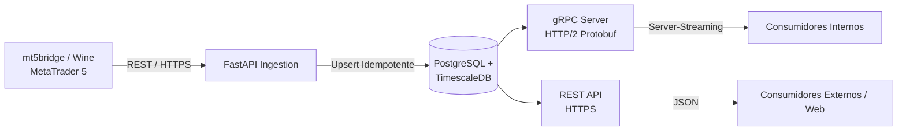

# Estado Atual da Plataforma qDATA (TCC - Marco Estático)

> **Nota de Restrição (Regra de Ouro):**
> Os componentes descritos neste documento representam o escopo já construído, testado e validado no TCC de Luis Maia na UFC. **Esta base não será alterada nem reescrita.** Todo o planejamento contido neste repositório visa exclusivamente os **Trabalhos Futuros (Seção 6.4 do TCC)** e a evolução para o Mestrado.

---

## 1. Visão Geral da Arquitetura
A plataforma qDATA foi projetada como uma infraestrutura centralizada e headless de aquisição, persistência e distribuição de Market Data, implantada sobre contêineres Docker em ambiente Linux.

---

## 2. Componentes Implementados

### 2.1. Aquisição de Dados (Feeder - `mt5bridge`)
- Execução do terminal MetaTrader 5 sob camada Wine em Linux.
- Conexão configurada para corretoras locais (XP, Rico, Inter).
- Coleta ativa de barras OHLCV de 1 minuto (M1) do Mini-Índice Ibovespa (WIN).
- Suporte conceitual preparado para ticks de negócio (`COPY_TICKS_TRADE`), book de ofertas (`COPY_TICKS_INFO`) e fluxo consolidado (`COPY_TICKS_ALL`).

### 2.2. Ingestão e Persistência de Dados
- API de ingestão assíncrona desenvolvida com FastAPI.
- Estratégia de escrita idempotente: *Upsert* (`INSERT ... ON CONFLICT DO UPDATE`), eliminando duplicações em retransmissão de pacotes.
- Banco de dados relacional PostgreSQL equipado com a extensão **TimescaleDB**:
  - Tabelas hiper-particionadas por tempo (*hypertables*).
  - Otimização para séries temporais financeiras de alta densidade.

### 2.3. Distribuição e Acesso
- **gRPC Nativo:** Comunicação via HTTP/2 com Protocol Buffers e suporte a *server-streaming*.
- **gRPC-Web & REST/HTTPS:** Pontos de extremidade para integração com aplicações web e clientes de menor complexidade.
- **Autenticação & RBAC:** Modelo stateless baseado em JSON Web Tokens (JWT) e integração com Supabase.
- **Borda e Segurança:** Proxy reverso Traefik e cofre de segredos via Bitwarden.

---

## 3. Principais Resultados Empíricos do TCC
Os experimentos de benchmark conduzidos no TCC revelaram que:
1. **REST/HTTPS:** Apresenta menor barreira de adoção e baixo overhead para consultas transacionais pontuais (poucos kilobytes).
2. **gRPC Server-Streaming:** Reduziu a latência média em **50%** e **dobrou o throughput** em cenários de alta volumetria (conjunto de teste com 16.865 barras / 2 meses de pregão).
3. **Decisão Arquitetural:** O gRPC é formalmente consolidado como o protocolo de barramento interno para comunicação entre serviços quantitativos e motores de streaming.
