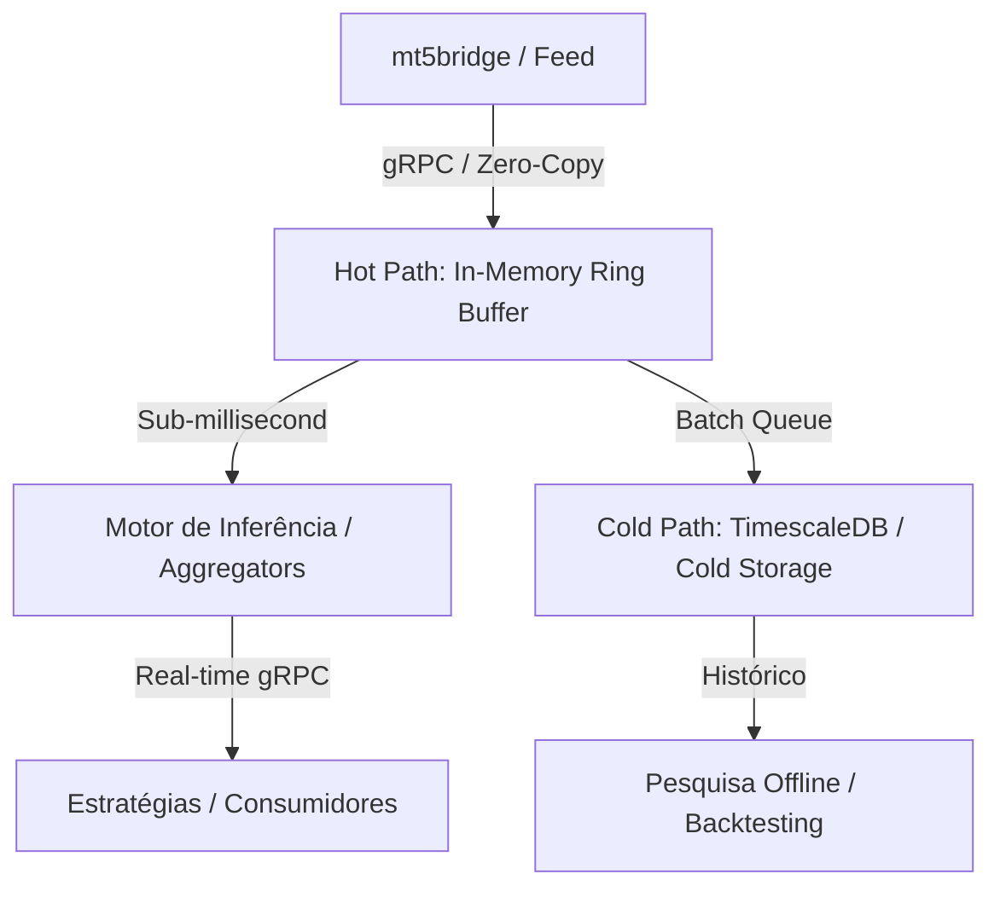

# Seção 6.4.4: Engenharia de Baixa Latência e Replay Determinístico

## 1. Desafios de Confiabilidade em Sistemas Quantitativos
Em ambientes de negociação algorítmica, dois erros arquiteturais são fatais:
1. **Sobrecarga de Persistência no Caminho Crítico:** Gravar em disco no mesmo thread/processo que recebe cotações induz *jitter* de latência e perda de pacotes.
2. **Viés de Antecipação (*Look-Ahead Bias*):** Testar estratégias em dados que continham revisões futuras ou timestamps desordenados invalida qualquer validação de modelo estatístico.

---

## 2. Inovações Arquiteturais Propostas

### 2.1. Pipeline Híbrido: Hot Path vs. Cold Path
Separação estrita dos caminhos de execução:
- **Hot Path (Caminho Crítico / Em Memória):**
  - Recebe os ticks do feeder (`mt5bridge`) via gRPC/IPC.
  - Alimenta os buffers circulares em memória (*Ring Buffers* com modelo Disruptor / Zero-Copy).
  - Distribui eventos para motores de amostragem e algoritmos de execução em latência sub-milissegundo.
- **Cold Path (Caminho de Persistência / Assíncrono):**
  - Consome dos buffers de memória de forma desacoplada via *batch writes*.
  - Gravação em PostgreSQL/TimescaleDB com compressão colunar e *Continuous Aggregates* para auditoria, histórico e treinamento offline.

### 2.2. Motor de Replay Determinístico (*Point-in-Time Correctness*)
- Capacidade de reproduzir o mercado com ordenação estrita baseada no timestamp original da bolsa ($T_{\text{exchange}}$) e não no timestamp de recepção local ($T_{\text{local}}$).
- O motor de replay emite streams gRPC que simulam um ambiente ao vivo, permitindo que qualquer algoritmo seja testado com fidelidade absoluta de estado, eliminando *look-ahead bias*.

---

## 3. Avaliação pela Dupla Lente

### Lente de Engenharia de Software
- **Desafio:** Implementação de estruturas livres de travas (*lock-free queues*), minimização de *garbage collection* ou troca de contexto, e sincronização determinística de múltiplos streams assíncronos.

### Lente Quantitativa e Estatística (Conexão IME-USP / ABE)
- **Fundamentação:** Garantia formal da filtragem temporal: o processo estocástico adaptado deve respeitar estritamente a história acumulada $\mathcal{F}_t = \sigma(X_s : s \le t)$, assegurando que nenhuma informação de $t' > t$ contamine a esperança condicional estimada $\mathbb{E}[X_{t+1} \mid \mathcal{F}_t]$.

### Pitch de Mercado (2 Linhas)
> *"Projetei uma arquitetura híbrida com desacoplamento Hot/Cold Path e um motor de replay determinístico point-in-time via gRPC, eliminando look-ahead bias em simulações quantitativas de alta fidelidade."*
