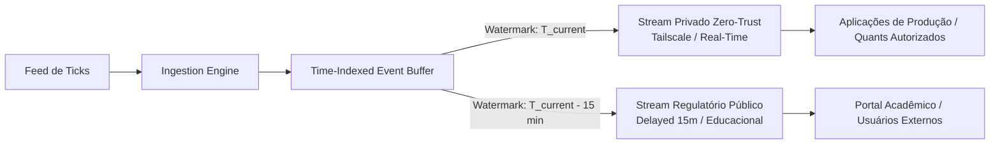

[← Anterior: 04. Baixa Latência e Replay Determinístico](04_arquitetura_distribuida_replay.md) | [Índice Geral](../../README.md) | [Módulo Mestrado: Cronograma ABE →](../mestrado/cronograma_abe_16_semanas.md)

---

# Seção 6.4.5: Governança Regulatória e Roteamento Dual-Stream

## 1. Contexto Regulatório e Restrições da B3
A redistribuição de dados de mercado em tempo real da B3 sujeita a infraestrutura a contratos rigorosos de licenciamento de Market Data. Dados com atraso igual ou superior a 15 minutos (*Delayed Market Data*), por sua vez, contam com políticas muito mais brandas, sendo ideais para pesquisa acadêmica aberta, validação de alunos e serviços educacionais.

---

## 2. Solução Arquitetural: Watermark-based Dual-Stream Routing

Em vez de manter dois sistemas ou bancos de dados separados, o qDATA futuro projeta um padrão de **Roteamento Dual-Stream Baseado em Marcas d'Água (*Watermarks*)**:

### Características do Sistema:
1. **Buffer Central Único Indexado por Tempo:** Os eventos são mantidos em uma fila circular em memória.
2. **Ponteiro de Tempo Real:** Consumidores internos autenticados acessam a cabeça do buffer ($t = T_{\text{current}}$) através de uma malha privada Zero Trust (Tailscale/WireGuard), isolada da internet pública.
3. **Ponteiro com Atraso Determinístico:** Consumidores externos e acadêmicos recebem eventos de um cursor defasado ($t = T_{\text{current}} - \Delta t$, onde $\Delta t = 15\text{ min}$), garantindo conformidade regulatória sem duplicar pipeline ou armazenamento.

---

## 3. Avaliação pela Dupla Lente

### Lente de Engenharia de Software
- **Desafio:** Implementação de gerenciamento de cursores concorrentes com baixa sobrecarga de memória e garantia de que nenhum pacote "vaze" do stream em tempo real para o canal com delay.
- **Segurança:** Isolamento perimetral via WireGuard/Tailscale com autenticação mTLS e RBAC stateless via JWT.

### Lente Quantitativa e Estatística (Conexão IME-USP / ABE)
- **Fundamentação:** Modelagem de atrasos estocásticos de fila e garantia de invariância distributiva: o stream atrasado é exatamente uma translação temporal determinística do processo estocástico original $\{X_t\}_{t \ge 0} \to \{X_{t - \tau}\}_{t \ge \tau}$.

### Pitch de Mercado (2 Linhas)
> *"Desenvolvi um motor de roteamento dual-stream com controle de watermark temporal, servindo simultaneamente fluxos em tempo real via Zero Trust e dados regulatórios B3 com delay de 15 minutos a partir de um único buffer de memória."*
